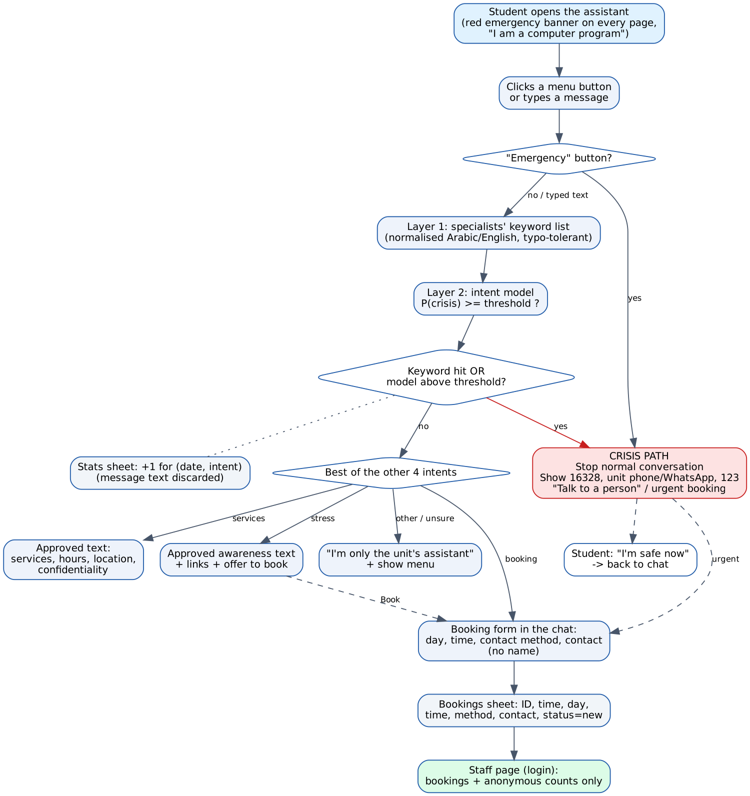
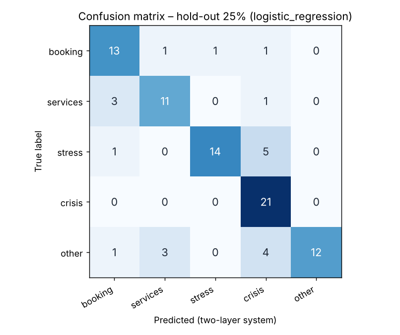

# Counselling Unit Support Assistant (AI Lab, Project 2)

> **Last updated: 2026-11-16 13:07 (Cairo time)**. This file is regenerated automatically on every change pushed to the repository.

A 24/7 "front door" for the faculty's counselling and guidance unit. It explains the unit's services, books a session
**without asking for a name**, shows awareness articles, and at **any sign of crisis** stops the conversation and shows
the unit's contacts and the national mental-health hotline **16328**. It is not a therapist: it never diagnoses and never
gives treatment advice.

## Contents
1. [Quick start](#1-quick-start)
2. [How it works](#2-how-it-works)
3. [Brief requirements → implementation](#3-brief-requirements--implementation)
4. [Data (live statistics)](#4-data-live-statistics)
5. [Latest results](#5-latest-results)
6. [Privacy](#6-privacy)
7. [How updates work (GitHub sync)](#7-how-updates-work-github-sync)
8. [Documents](#8-documents)
9. [File inventory](#9-file-inventory)
10. [Change log (every change with date and time)](#10-change-log-every-change-with-date-and-time)

## 1. Quick start
```bash
git clone https://github.com/pikachu8240/Counselling-Unit-Support-Assistant.git
cd Counselling-Unit-Support-Assistant
python -m venv venv && venv\Scripts\activate      # macOS/Linux: source venv/bin/activate
pip install -r requirements.txt
python train.py        # NB vs LR comparison + crisis threshold
python evaluate.py     # metrics + PASS/FAIL gate
python app.py          # http://127.0.0.1:5000
python -m pytest -q    # automated tests
python try_model.py    # try the AI on your own messages (or use /staff/try in the app)
```
Staff page: `/staff/login`. Default user `staff` / password `change-me-now` (change via `STAFF_PASSWORD_HASH`, see README).
Replace the placeholder unit contacts in `config.py`.

## 2. How it works


1. Every page shows a red emergency banner (16328, unit phone, "Talk to a person"). The assistant says it is a program.
2. **Every message is checked for crisis first**, with two layers:
   **Layer 1** is the specialists' keyword list (normalised Arabic/English, typo-tolerant) and **Layer 2** is the intent
   model's P(crisis) ≥ threshold. If either fires, the conversation stops and real contacts are shown.
3. Otherwise the message is classified as booking / services / stress / other and answered **only** from approved content,
   or the booking form opens (day, time, contact method, contact; no name).
4. Staff log in to see bookings and anonymous counts only.

## 3. Brief requirements → implementation
| Requirement | Where |
|---|---|
| Welcome, chat (menu + free text), booking form, awareness pages, staff page with login | `app.py`, `templates/` |
| Intent classifier, 5 classes, Naive Bayes vs Logistic Regression | `core/model.py`, `train.py` |
| Two-layer crisis check, threshold so no crisis is missed | `core/crisis.py`, `train.choose_threshold()` |
| ≥ 250 messages / ≥ 40 per class / separate crisis test ≥ 30 | `data/` (see section 4) |
| Accuracy, confusion matrix, crisis recall 100% gate, false-alarm rate | `evaluate.py`, `reports/`, page `/staff/evaluation` |
| Trick testing, failures recorded and fixed | `data/trick_tests.csv`, `docs/trick_testing_log.md` |
| `bookings.xlsx` (Bookings / Stats / Visits), no names, no chat text | `core/excel_db.py`, single writer `log_to_excel()` |
| Privacy statement · data card · flowchart · demo script | `docs/` |
| Bonus: Egyptian dialect, accessibility | Arabic normalisation + char n-grams; font size, contrast, ARIA, RTL, mobile |

## 4. Data (live statistics)
| Dataset | File | Messages | Notes |
|---|---|---|---|
| Training data | `data/messages.csv` | **366** | booking 65 · crisis 82 · other 78 · services 60 · stress 81 |
| Crisis test set (never trained on, PASS/FAIL gate) | `data/crisis_test.csv` | 36 | all `crisis` |
| Trick tests (indirect wording) | `data/trick_tests.csv` | 24 | all `crisis` |
| False-alarm set (non-crisis, hyperbole) | `data/false_alarm_test.csv` | 40 | all `not_crisis` |
| Crisis keyword list (Layer 1) | `data/crisis_keywords.txt` | 124 entries | owned by the unit's specialists |

Brief check: ≥ 250 messages → **✅** · ≥ 40 per class → **✅** · crisis test ≥ 30 → **✅**

Sources: `specialist_draft` 82, `team_draft` 237, `team_rewording_v2` 35, `team_rewording_v3` 12 · rows still pending specialist approval: **366**

## 5. Latest results
_From `reports/metrics.json` (evaluation generated 2026-11-15 21:33 Cairo)._

| Metric | Value |
|---|---|
| **Crisis recall on crisis test set (pass/fail)** | **100%: PASS ✅** (36 messages) |
| Caught by keyword layer alone / model alone | 56% / 97% |
| Selected model / crisis threshold | logistic_regression / 0.2485 |
| Hold-out accuracy (two-layer) / macro-F1 | 0.772 / 0.768 |
| False-alarm rate: hold-out non-crisis | 15.5% |
| False-alarm rate: hard hyperbole set | 25.0% |
| Trick tests caught | 100% of 24 |

Per class (hold-out):

| Class | Precision | Recall | F1 | n |
|---|---|---|---|---|
| booking | 0.722 | 0.812 | 0.765 | 16 |
| services | 0.733 | 0.733 | 0.733 | 15 |
| stress | 0.933 | 0.7 | 0.8 | 20 |
| crisis | 0.656 | 1.0 | 0.792 | 21 |
| other | 1.0 | 0.6 | 0.75 | 20 |

Robustness (crisis recall under perturbation): elongation 100% · punctuation 100% · typo_swap 100% · no_hamza 100%



## 6. Privacy
- Stored (in `instance/bookings.xlsx` on the unit's computer **only**, never in this repository): booking ID, request time,
  preferred day/time, contact method, contact, status · daily intent totals · page visits (page + date) · helpful yes/no.
- **Never stored:** names, chat text, IP, device or location. `log_to_excel()` refuses any field outside this schema.
- `instance/` is git-ignored on purpose, so real student bookings can never be pushed to GitHub.
- Full statement: [`docs/privacy_statement.md`](docs/privacy_statement.md)

## 7. How updates work (GitHub sync)
- **Any change pushed to `main`** (code, interface, data, docs) triggers the GitHub Action
  `.github/workflows/update-project.yml`, which:
  1. retrains and re-evaluates the model **if data or model code changed** and commits the new `models/` and `reports/`;
  2. regenerates **this file** (statistics, results, file inventory, change log with date and time) and commits it.
- From your laptop: run **`sync.bat`** (Windows) or **`./sync.sh`**. It asks for a short description, commits everything,
  pushes, and the Action updates this file within about a minute.
- To share the project: **Code → Download ZIP** on GitHub, or `git clone`. Everything (data, model, reports, docs) is included.

## 8. Documents
| Document | Content |
|---|---|
| [`README.md`](README.md) | Setup and structure |
| [`docs/data_card.md`](docs/data_card.md) | Data source, size, labels, collection, privacy |
| [`docs/privacy_statement.md`](docs/privacy_statement.md) | One-page privacy statement |
| [`docs/trick_testing_log.md`](docs/trick_testing_log.md) | Every failure found and how it was fixed |
| [`docs/presentation_demo_script.md`](docs/presentation_demo_script.md) | 10-minute demo plan |
| [`docs/ai_explained.md`](docs/ai_explained.md) | Where the AI lives, what it does with a message, how to test it |
| [`docs/design_inspiration.md`](docs/design_inspiration.md) | Researched design references and mental-health UX principles |
| [`docs/conversation_flowchart.png`](docs/conversation_flowchart.png) | Conversation flowchart (source `flowchart.dot`) |
| [`docs/screenshots/`](docs/screenshots) | Screenshots of every page |

## 9. File inventory
| File | Size | Last changed (Cairo) |
|---|---|---|
| `.gitattributes` | 37 B | 2026-11-15 21:15 |
| `.gitignore` | 50 B | 2026-11-15 21:15 |
| `README.md` | 5.6 KB | 2026-11-15 21:15 |
| `app.py` | 15.2 KB | 2026-11-15 21:15 |
| `config.py` | 2.6 KB | 2026-11-15 21:15 |
| `evaluate.py` | 8.8 KB | 2026-11-15 21:15 |
| `requirements.txt` | 107 B | 2026-11-15 21:15 |
| `sync.bat` | 587 B | 2026-11-15 21:15 |
| `sync.sh` | 496 B | 2026-11-15 21:15 |
| `train.py` | 5.5 KB | 2026-11-15 21:15 |
| `try_model.py` | 2.4 KB | not committed yet |
| `core/__init__.py` | 0 B | 2026-11-15 21:15 |
| `core/content.py` | 10.5 KB | 2026-11-15 21:15 |
| `core/crisis.py` | 3.1 KB | 2026-11-15 21:15 |
| `core/excel_db.py` | 3.9 KB | 2026-11-15 21:15 |
| `core/model.py` | 4.0 KB | 2026-11-15 21:15 |
| `core/text_clean.py` | 1.4 KB | 2026-11-15 21:15 |
| `data/crisis_keywords.txt` | 3.7 KB | 2026-11-15 21:15 |
| `data/crisis_test.csv` | 1.6 KB | 2026-11-15 21:15 |
| `data/false_alarm_test.csv` | 2.1 KB | 2026-11-15 21:15 |
| `data/messages.csv` | 28.5 KB | 2026-11-15 21:15 |
| `data/trick_tests.csv` | 1.1 KB | 2026-11-15 21:15 |
| `docs/ai_explained.md` | 4.4 KB | not committed yet |
| `docs/conversation_flowchart.png` | 241.8 KB | 2026-11-15 21:15 |
| `docs/data_card.md` | 2.2 KB | 2026-11-15 21:15 |
| `docs/design_inspiration.md` | 3.3 KB | not committed yet |
| `docs/flowchart.dot` | 2.2 KB | 2026-11-15 21:15 |
| `docs/presentation_demo_script.md` | 2.0 KB | 2026-11-15 21:15 |
| `docs/privacy_statement.md` | 2.3 KB | 2026-11-15 21:15 |
| `docs/trick_testing_log.md` | 4.8 KB | 2026-11-15 21:15 |
| `docs/screenshots/1_home.png` | 175.5 KB | 2026-11-15 21:15 |
| `docs/screenshots/2_booking_form.png` | 197.8 KB | 2026-11-15 21:15 |
| `docs/screenshots/3_booked.png` | 137.5 KB | 2026-11-15 21:15 |
| `docs/screenshots/4_crisis.png` | 165.1 KB | 2026-11-15 21:15 |
| `docs/screenshots/5_staff.png` | 159.7 KB | 2026-11-15 21:15 |
| `docs/screenshots/6_eval.png` | 490.4 KB | 2026-11-15 21:15 |
| `docs/screenshots/7_mobile.png` | 79.5 KB | 2026-11-15 21:15 |
| `docs/screenshots/8_ai_test_bench.png` | 175.5 KB | not committed yet |
| `models/intent_model.joblib` | 545.8 KB | 2026-11-15 21:34 |
| `reports/confusion_matrix.png` | 46.0 KB | 2026-11-15 21:34 |
| `reports/crisis_test_results.csv` | 2.6 KB | 2026-11-15 21:15 |
| `reports/false_alarm_results.csv` | 2.5 KB | 2026-11-15 21:15 |
| `reports/metrics.json` | 2.9 KB | 2026-11-15 21:15 |
| `reports/model_selection.json` | 757 B | 2026-11-15 21:15 |
| `reports/trick_results.csv` | 1.7 KB | 2026-11-15 21:15 |
| `static/a11y.js` | 916 B | 2026-11-15 21:15 |
| `static/chat.js` | 7.0 KB | 2026-11-15 21:15 |
| `static/style.css` | 10.8 KB | 2026-11-15 21:15 |
| `templates/article.html` | 654 B | 2026-11-15 21:15 |
| `templates/awareness.html` | 714 B | 2026-11-15 21:15 |
| `templates/base.html` | 2.5 KB | 2026-11-15 21:15 |
| `templates/chat.html` | 4.3 KB | 2026-11-15 21:15 |
| `templates/index.html` | 2.2 KB | 2026-11-15 21:15 |
| `templates/message.html` | 218 B | 2026-11-15 21:15 |
| `templates/privacy.html` | 2.8 KB | 2026-11-15 21:15 |
| `templates/talk.html` | 711 B | 2026-11-15 21:15 |
| `templates/staff/dashboard.html` | 3.5 KB | 2026-11-15 21:15 |
| `templates/staff/evaluation.html` | 4.2 KB | 2026-11-15 21:15 |
| `templates/staff/login.html` | 923 B | 2026-11-15 21:15 |
| `templates/staff/try.html` | 3.6 KB | not committed yet |
| `tests/test_app.py` | 4.8 KB | 2026-11-15 21:15 |
| `tools/build_project_md.py` | 14.2 KB | 2026-11-15 21:33 |
| **Total** | **2.6 MB** | |

## 10. Change log (every change with date and time)
Total changes recorded: **5** (newest first, times in Cairo, UTC+2)

### 2026-11-15 · 21:34 | docs: auto-update project MD 2026-11-15 21:34 [skip ci]
`168dd0c` by project-bot

- modified `models/intent_model.joblib`
- modified `reports/confusion_matrix.png`

### 2026-11-15 · 21:33 | docs: update project MD before first push
`6da5150` by Ahmed Hallawa

### 2026-11-15 · 21:33 | Point repository links to pikachu8240/Counselling-Unit-Support-Assistant
`7f7bdac` by Ahmed Hallawa

- modified `tools/build_project_md.py`

### 2026-11-15 · 21:15 | docs: add project MD file (auto-generated)
`f2b5cf8` by Ahmed Hallawa

### 2026-11-15 · 21:15 | Initial project: Counselling Unit Support Assistant (AI Lab Project 2)
`849a187` by Ahmed Hallawa

- added `.gitattributes`
- added `.github/workflows/update-project.yml`
- added `.gitignore`
- added `README.md`
- added `app.py`
- added `config.py`
- added `core/__init__.py`
- added `core/content.py`
- added `core/crisis.py`
- added `core/excel_db.py`
- added `core/model.py`
- added `core/text_clean.py`
- added `data/crisis_keywords.txt`
- added `data/crisis_test.csv`
- added `data/false_alarm_test.csv`
- added `data/messages.csv`
- added `data/trick_tests.csv`
- added `docs/conversation_flowchart.png`
- added `docs/data_card.md`
- added `docs/flowchart.dot`
- added `docs/presentation_demo_script.md`
- added `docs/privacy_statement.md`
- added `docs/screenshots/1_home.png`
- added `docs/screenshots/2_booking_form.png`
- added `docs/screenshots/3_booked.png`
- … and 33 more files

